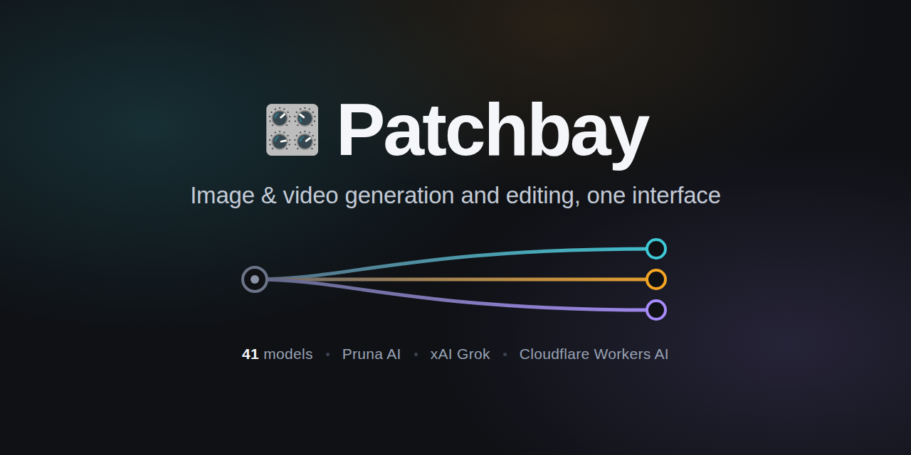

<p align="center">
  
</p>

Patchbay is a web front end for image and video generation and editing. It puts
50 models from three providers behind one interface and runs entirely on
Cloudflare Workers — no server to maintain, no build step, no framework.

| Provider | Models | Credentials |
|----------|--------|-------------|
| [Pruna AI](https://docs.api.pruna.ai/) | 32 | `PRUNA_API_KEY` |
| [Cloudflare Workers AI](https://developers.cloudflare.com/workers-ai/models/) | 13 | none |
| [xAI (Grok)](https://docs.x.ai/) | 5 | `XAI_API_KEY` |

A further 42 models run behind the prompt tools rather than appearing in the
picker: 32 Workers AI models rewrite prompts, 33 hold the chat, 9 vision models
caption images — all nine of which can also be shown the attached images in the
chat, and eight of which can rewrite for Improve — 7 embedding models measure
text in the Embeddings panel, and Pruna's `p-judger` scores an image against a
prompt.

## Features

**Three screens.** *Create* holds what making a picture needs, top to bottom: the model; the mode, where a model has one, since
it decides which inputs apply; every file the model takes, required or not,
under *Inputs*; *Settings*; and last the prompt with its tools under it, right
above Generate and the output.
The output follows the form on a phone and sits beside it on a wide screen. A
finished result does not move the page: it lands in the output panel wherever
that is. *Start over* clears the panel along with the form. *Gallery* holds everything made so
far (below). *Lab* holds the tools that are not part of making a picture —
the chat, Translate, scoring images, Embeddings and Other. A bar fixed to the bottom
of the screen carries the status line and Generate, so neither a run's
progress nor the button that starts one is ever scrolled out of reach; a long
message is clamped to two lines and opens on a tap.

**The prompt tools.** Under the prompt, one row of five text buttons: Prompts,
Models, Improve in the middle, then Undo and Redo. *Models* picks the model Improve uses;
Describe's model is in the gallery's *Settings*, beside Describe itself. The interface carries no emoji.

**One picker, grouped by task.** Models are filed under Image editing, Image
generation, Video, Audio and LoRA training, each split by provider — provider decides
what a model costs and which key it needs, and two of them ship FLUX.2 Klein 4B
under the same name.

**Settings.** Every optional parameter is in plain view and pre-filled, two to
a row (free text and files take the full width). A changed one names its
default beside it. There is no per-setting reset: *Start over*, beside the
model, puts every setting back and clears the inputs and the prompt. Turbo (every fast-mode switch,
whatever the provider calls it) and the content moderation filter are not
shown at all: both are always off, and off is sent explicitly wherever a
provider would otherwise turn one on. A
parameter is sent only when it differs from the provider's default, so what you
see is what the provider would do anyway. Optional *files* — start and end
frames, audio tracks, reference images, a pose — are not settings: they sit
with the required inputs, marked optional, where they cannot be missed.

**Mode switching.** Grok's video model reaches three different endpoints —
generate, edit, extend. Picking a mode changes which fields apply, and fields
belonging to another mode are never sent.

**Prompt rewriting.** Improve runs the prompt through one of 32 Workers AI
models as a copy edit: grammar, phrasing and punctuation only. It adds nothing,
drops nothing, keeps your pronouns and your grammatical mood, and avoids commas,
which image models read as tag separators rather than punctuation. It reads the
prompt text and nothing else. Its model is picked under Models. While it runs
the button is its Cancel. Reverting a
rewrite is the prompt Undo button's job, so the button stays Improve rather than
turning into a one-shot undo of its own.

**Image description.** Describe, on each image in the gallery's viewer,
captions that image with one of 9 Workers AI vision models and drops the
caption into the prompt box on Create as a starting prompt (one Undo step). Its
model and its own settings are in the gallery's *Settings*. Its instruction
is editable like Improve's and the chat's. Moondream's caption mode takes no text, so with an instruction of
your own it is asked as a question through its `query` mode instead.

**Chat.** A conversation about the prompt, on its own card in Lab: a thread, a multi-line box where Enter adds a line, and a Send button.
Every message sends the whole thread, so the model remembers the conversation,
and the thread stays on this device until *New chat*. What else the next
message carries is set by two separate controls. *Prompt box* adds the prompt
text, and stays as set. Each attached image has a chip of its own, numbered as
the Inputs show them; a ticked chip sends that image with the next message, to
a vision model (marked "(vision)" in the picker). Every Send unticks all the chips — Workers AI keeps nothing
between calls, so a follow-up about a picture has to carry the picture, and a
tap ticks it again. All six vision chat models were checked with two images in
one message and named each correctly, so several go at once, each as its own
part. The thread notes which images each message carried. The reply streams in
as it is written; while it does, Send is Cancel, and a cancelled or failed
message goes back into the box with its images ticked again. Any reply can be
put in the prompt box on Create as one Undo step, and each shows the neurons it actually
used, as reported by Cloudflare. It talks to Improve's 32 models plus LLaVA —
every vision model the app has. Three of them take the
conversation differently, per their schemas: Llama 3.2 Vision holds a real
thread but takes one image beside it; Moondream (through its `query` mode) and
LLaVA answer one question at a time, so the conversation goes to them as a
transcript. All three take one image per message, so several ticked images go
to them combined into one picture, each numbered as its chip is. LLaVA's
schema requires an image on every call: it is in the chat but not in Improve,
and it will not send without one ticked. Images sent to any tool are scaled to 1,024 pixels on the
long edge first: a phone photo is several megabytes as base64, which was the
slow part of every message on a mobile connection.

**Model settings are per model.** Every setting belongs to the model it was
set on: the instruction and its earlier versions, the token limit, Thinking and
Reasoning effort, and each sampling parameter. Nothing is shared between a
tool's models. A device that saved an instruction back when it was shared has
it copied into each of that tool's models once, so what they send is
unchanged.

**Improve's settings.** *Tune*, beside the Improve model under *Models*, opens
a sheet for the picked model alone, headed by its name and its Cloudflare id:
the instruction, then `max_tokens` and, where the model takes them,
`enable_thinking`, `reasoning_effort` and its sampling parameters
(`temperature`, `top_p`, `top_k`, `seed`, `repetition_penalty`,
`frequency_penalty`, `presence_penalty`). An empty field is not sent: it shows
the model's own default greyed out, or a dash where Cloudflare documents none
(its models/schema API, probed again 2026-10-13: the older Workers AI models
publish none for `top_p`, `top_k`, `seed` or the penalties). A choice shows
the value that is sent when nothing is picked. Each field says what it does
and its range, and a model whose penalties can go below the neutral point
says that doing so makes repetition more likely. The sheet does not zoom: its
fields are 16px so iOS does not zoom into one, and the page's zoom is locked
while it is open.

The ranges are what the service accepts, found by sending each end of every
range to every Improve model (600 calls, 2026-10-13), not what the schemas
say. Every model refuses `top_p` 0 and 2 and `repetition_penalty` 0; eight
refuse `temperature` above 2 ("temperature must be in [0, 2]"); five refuse
negative penalties. The newer chat models (DeepSeek V4, Gemma 4, GLM, Kimi,
Nemotron, Qwen 3.8) take `temperature` 0–2, `top_p` 0.001–1 and penalties
−2–2, as in Thread. From Thread's own testing (reloru/Thread): GPT-OSS 20B and
120B are held to `temperature` 1 and 1.2 and `repetition_penalty` 0.7 and up,
past which replies came back empty or garbled; Granite and Mistral Small say
that above about 2 replies turned to nonsense; and GLM 5.3, GLM 5.3 Flash,
Gemma 4, DeepSeek V4 and Kimi offer no `seed`, which did not repeat a reply
there. Llama 3.1 8B Fast v2 has no schema and takes the token limit only.
The Worker drops a value outside a model's range rather than send it to be
refused.

**How the tools work.** The guide in Lab describes every tool on the same
five rows — *Model*, *Reads*, *Instruction*, *Limits*, *Writes to* — except
Improve, whose tab is the same settings as its sheet; the chat's and
Describe's *Tune* open it at their tab. The other tools' rows name the input
their model has instead of an instruction: m2m100 takes text and two language
codes; p-judger a prompt and images, and refuses any other key; Llama Guard,
DistilBERT, ResNet-50 and the reranker have no instruction input in their
schemas; the embedding models measure text as a document.

An instruction is a draft until saved: typing changes nothing that is sent, ↶
and ↷ step through the draft, *Revert to saved* puts the saved text back,
*Load default* puts the app's own text in the draft (still undoable), and
every Save keeps the text it replaced among that model's last ten versions.
Closing over an unsaved draft asks first. Nothing is stored server-side: the
settings live in this browser and ride along with each request, and the
Worker caps them (instruction 4,000 characters, token limit 16–8,000). An
orange *Tune* means the picked model has something set.

**Deadlines and streaming.** Improve, Describe and the chat answer as
server-sent events, following Cloudflare's guidance to stream "especially for
larger models or reasoning models": a ping at once and every 10 seconds, the
text as it arrives, then the result. `env.AI.run()` takes no timeout of its
own, so the deadline is kept on silence rather than on the total: the Worker
gives up when the model sends nothing for 60 seconds (120 for LLaVA and
Moondream, which answer in one piece), and the browser gives up after 60
seconds with no word at all, which only a lost connection explains. A long
answer that keeps arriving is never cut off. Translate, speech to text,
Embeddings, Other and Judge are one-shot calls with a 60-second deadline. Each
failure says so in words, and says the call may still have been billed.

**Llama 2 7B Chat LoRA is not offered.** It produces no language: on
2026-09-28 every call returned unrelated tokens — through `messages`
(Cloudflare's own usage example verbatim), a plain `prompt`, and a `raw`
prompt in its full `<s>[INST] <<SYS>>` template, streamed or not — and with
`temperature` 0 and `top_k` 1 an empty string after spending every token. It
does the same in Cloudflare's playground. `src/models.js` keeps the entry it
would take if that is fixed.

**Translate.** The Translate card in Lab rewrites the prompt box on Create
from one language into the other with Meta's m2m100 (English, Spanish, French, German,
Portuguese, Russian, Arabic, Hindi, Chinese, Japanese — the languages
Cloudflare lists for it). Undo brings the original back.

**Speaking to the chat.** *Mic* beside Send records a message and transcribes
it into the chat box — added, not sent, so it can be corrected first. Tap
*Stop* to stop. Where a browser cannot record, it opens a picker for a recording
instead. The model is chosen in *How the tools work*, from the chat's *Tune* or
the *Speech to text* tab: Whisper Large v3 Turbo (the
default), Whisper, Whisper Tiny EN or Deepgram Nova-3, each sent the audio in
the form its schema documents. All four transcribed both an iPhone-style
AAC/MP4 clip and a WebM/Opus clip in testing. Deepgram Flux is not offered:
Cloudflare serves it over a WebSocket only.

**Other.** In Lab, a section for the catalogue models that fit nowhere else:
a safety check with Llama Guard 3 8B, sentiment with DistilBERT SST-2, image
labels with ResNet-50 (on the attached image, or a picked one), and ranking
passages against a query with the BGE reranker.

**Embeddings.** In Lab, a panel of its own, with its own text box: write something,
change it, and watch the numbers move. About a second after you stop typing
the text is measured by one of 6 Workers AI embedding models, which turns it
into a list of numbers placed by meaning (384 to 2,048 of them, by model).
Each version shows how close it is to the baseline — the first version, or
any you set — and to the version before it, on a 0–1 scale, and draws its
numbers as a barcode with a second strip for what changed since the previous
version. Pause stops the automatic measuring; Measure now works either way.
Versions are kept on this device, separately per model, since lists from
different models cannot be compared. Each request follows the model's
documented schema: `contexts` for BGE M3, `cls` pooling for the English BGE
models, as Cloudflare recommends. A measurement costs about a tenth of a
neuron.

**Prompt-match scoring.** Judge runs Pruna's `p-judger` over an image and
returns how well it matches the prompt, from the *Score images* card in Lab. It
scores the generated image on screen or, failing that, the attached ones, and its note always
says which — with an inline link to a file picker for anything else, which also
reaches batch mode (up to 10 images against a shared prompt).

**Uploads.** Init images, edit references, start and end frames, masks, and
source video or audio are proxied to the provider and referenced by URL.

**Reuse an output as an input.** A finished image can go straight back in as
the thing to edit or as a reference, without a trip through the camera roll.
The button names its target before you press it — Edit this when the image
becomes an editing model's subject, Use as reference when it joins a prompt,
and Edit in P-Image-Edit when the current model has nowhere to put it, which
switches and carries the image across. The receiving field is scrolled into
view and named in the status line — every file field is under Inputs, in plain
view — so the tap never reads as having done nothing. A reused image
is an ordinary upload from there on: it gets the provider encoding that model
needs, and the saved session keeps it.

**Cost visibility.** List prices per model, live estimates that follow your
settings, and Workers AI neuron consumption against the free daily allowance —
in a few characters on the ⚡ pill at the top, which opens the full line.
The account is on Workers Paid, where use past the 10,000 free neurons is
billed at $0.011 per 1,000 rather than refused, so the meter turns amber at
8,000 and red at 10,000, and past that shows the overage and what it has cost
today.

**How long this normally takes.** A bare "Processing… 200s elapsed" is
indistinguishable from a hang, which is exactly how a correct run of a
multi-minute model reads. Every run the app watches start to finish is timed,
and the median of the last few for that model is shown alongside the elapsed
count. Measured rather than catalogued, because a hand-set figure existed for
one model out of 48 and a measured one describes this account, this device and
this connection. A run collected on reload is not counted — its elapsed time is
measured from reattaching and says nothing about the model.

The count is driven by its own clock rather than by the polling, and repaints
the moment the tab comes back. The status line used to be written only when a
poll returned, so a slow provider, a stalled connection or an iOS tab suspended
in the background left it frozen at whatever it last said — reading eight
seconds after three real minutes, which is worse than no count at all, since it
says the job has barely started.

It runs from the moment you press Generate, on one clock, whatever the model
does underneath. Sixteen of them never get a job id — Workers AI and
xAI's image endpoints run the whole generation inside a single request and
answer with the finished picture — so there is nothing to poll and nothing was
driving the status line: it held "Submitting…" for the entire run and then
jumped to the finished time. Those now count up from this side and say
*Generating* rather than *Submitting*, since that is what is happening. On a
polled model the submit leg and the polling share the same clock, so the count
does not restart at the handover.

**Resilient requests.** Dropped connections are retried, except where a retry
could bill twice — a generation that may already have reached the provider is
reported rather than repeated. That includes pulling the finished result down,
which is the largest transfer the app makes: losing those bytes costs the
archive too, since nothing is kept without them.

**Prompt undo/redo.** Undo and Redo on the tool strip cover the main
prompt box and nothing else (the instruction editor has its own). Typing is grouped into one entry per burst rather
than one per keystroke, and an Improve rewrite, a Describe caption, a loaded
saved prompt, a reused setup or a Reset is a single entry, so one press reverses the whole
replacement. Editing after an undo drops the redo tail, as it does in any
editor. The history is text rather than a handle on the element it was typed
into, so it survives switching models and a Reset; a model with no prompt field
holds it rather than dropping it, and the buttons come back with the next model
that has one. History is in memory only. `Cmd`/`Ctrl`+`Z` and
`Shift`+`Cmd`/`Ctrl`+`Z` work on a desktop keyboard while the prompt has focus;
the buttons exist because iOS offers no undo gesture that reaches a web
textarea.

**Prompt library.** *Prompts* lists every saved prompt with its text — four
lines of it, all of it on a tap — not just a name. Prompts are filed in
folders, searched by name, text or folder, sorted by date or name, and edited
in place (name, text, folder); deleting a folder keeps its prompts. *Save
current prompt* opens the same form, prefilled. Use replaces the prompt box as
one Undo step. Kept in this browser's localStorage; the flat list earlier
versions kept is moved over on first load.

**Session restore.** iOS discards a backgrounded PWA whenever it needs the
memory, and reopening it is a cold start. The current edit — attached files,
prompt text, selected model, and every option including which were deliberately
set — is kept in IndexedDB on the device and put back on the next load. Files are
stored as binary (which is what rules localStorage out) and come back as real
`File` objects, re-encoded for whichever provider the model uses, since last
session's upload URL has expired. Writes are debounced rather than hung off
`beforeunload`, which iOS does not fire for a page it is discarding. The file
half of the record is only rewritten when the set of attached files changes.
Blocked site data, Lockdown Mode or a full quota costs the restore and nothing
else.

**Gallery.** Every finished image and video is kept on the device with the
settings that made it and the files it was given. The *Gallery* tab shows them
as a grid: filter by kind and album, sort by date, name, model, file size or
any numeric setting (steps, seed, length…), reverse any order, and search.
Search matches words in prompts, names, models, albums and settings, and takes
`setting:value` (`seed:42`, `size:1280`), numeric comparisons (`steps>20`,
`guidance<=4`), `model:`, `album:`, `name:`, `prompt:`, `kind:video`, quoted
phrases and `-word` to rule one out. *Select* picks several to add to an album,
take out of one, or delete. Under the output on Create, the newest twelve sit
in a strip, with *Open gallery*.

Tapping an item opens it full screen: the picture or clip (*⤢* shows an image
at its own pixels to pan around), stepped with ‹ ›, a sideways swipe or the
arrow keys through the list it was opened from; the phone's Back closes it.
Under it: a name, its albums, the whole prompt with *Copy*, every setting with
the ones changed from the model's default marked — each with a 🔍 that finds
everything made with that value — and the input files. Its actions are
*Reuse parameters*, *Use as input* (the button names where it will go, as on a
fresh result), *Save* and *Delete*.

**Reuse parameters.** Puts the run back on Create: the model, every setting,
which settings were deliberately set (that flag alone decides whether a value
equal to the default is still sent), the prompt, and the files it was given,
re-encoded for the provider since last time's links have expired. It is one
Undo step for the prompt. *Restore setup* before this kept whatever happened to
be attached, or cleared it on a model switch, because the inputs were never
stored with the result; and a job collected on reload was kept with no prompt
or settings at all, so there was nothing to restore — every long video
collected by reopening the app was in that state. Both are kept now. Items
from before this have no stored inputs; reusing one leaves the attachments
alone and says so.

Inputs are stored once per file, keyed by a SHA-256 of their bytes, so one
reference image behind fifty runs is stored once; a file nothing refers to any
more is dropped. A source clip over 256 MB is not copied; the item says which
input could not be kept.

**Albums and names.** An item can be named and put in any number of albums,
from the viewer or for a selection. Deleting an album keeps its items.

**Nothing expires by default.** The gallery used to drop everything after seven
days and cap images at 200 and clips at 25. Now the caps — per kind, so clips
cannot evict stills — default to 2,000 images and 300 videos with no age
limit, and are settings under the gallery's *Settings* (up to no limit at all). A named
item or one in an album is never removed by them, only by Delete. The same sheet
shows how much storage the app uses against what the browser allows, and
whether the browser has made it persistent. The binding limit is the browser's
own quota — on a Home Screen web app a large share of the disk — and the app
asks for [persistent storage](https://webkit.org/blog/14403/updates-to-storage-policy/)
on load, since WebKit evicts a best-effort origin under storage pressure. A
result the browser refuses to store says so under the result.

A trained LoRA `.zip` is not kept. It is not previewable, and its link expires
about half an hour after the run either way.

Clearing the gallery does not disturb a generation in progress, and an archive
write already under way is dropped rather than landing in the gallery just
emptied — while a result that finishes later is still kept.

Stored as `ArrayBuffer`s rather than Blobs: WebKit aborts an IndexedDB
transaction outright for any value containing a Blob, which is how the session
store shipped broken once.

Each item is spread over three stores so each view reads only what it shows:
the metadata record (a few hundred bytes; search and the grid read every one),
its thumbnail (read for the tiles near the screen, and released again when
they scroll far off), and the media (read only to view, save or reuse it).
The grid is drawn in pages of 120.

**Jobs.** A run used to hold the whole app while it went, and *Stop waiting*
only stopped this tab watching — the job record was left for the next load to
collect, which reopening the app did anyway, button or not. Now each run is a
job of its own. Generate is held only while the provider is being asked; after
that the job runs beside whatever else you do, another generation included.
The chip beside Generate counts what is running and opens the list: each job's
state and elapsed time, *Check now*, and *Forget* (stop tracking it — nothing
can cancel it on the provider, so it may still be billed). Finished jobs stay
in the list for the visit, with *Open in gallery*. The run started last owns
the status line; one finishing beside it reports in the list. Runs that
overlap share the output panel: each result is added as it lands, captioned
with its model and prompt, and Judge scores them together. A run started with
nothing else going clears the panel first.

The poll loop no longer gives up on its own. It used to stop after a fixed 30
minutes, or after three failed status checks in a row, and say to reopen the
app — reopening then started a fresh loop that collected the result at once,
which is how a long video could only ever arrive by closing and reopening. A
dropped connection, a 5xx or a check that never answers is now retried with
backoff (2.5 s up to 30 s) for as long as the job record is worth keeping, and
every running job is checked again the moment the app comes back to the
foreground, the page is shown again, or the network returns. The per-run
timing record is saved as the run goes rather than only when it ends, so a run
that never finished in this tab still leaves one; a run picked up on load is
labelled as such, since its times count from reattaching.

**No server-side persistence.** Nothing is stored server-side. Generated media
is served `no-store`, so neither the browser nor Cloudflare's edge keeps a copy
in transit. What the browser keeps — the session above, the recent results and
their settings and inputs, saved prompts, measured runtimes, running jobs' ids —
never leaves the device.

**Job recovery.** A phone can discard the tab mid-generation to reclaim memory,
and the provider job keeps running and billing regardless. Each running job's
record is kept in this browser — its id and model, and the prompt, settings and
input references the gallery needs, never the API payload, since Workers AI
and xAI models carry base64 and `data:` URI images inline — so the next load
reattaches every one, polls it to completion and keeps the result with its
settings. A record is discarded once the result is kept, once the job
definitively fails, when it is forgotten, or after six hours for video and
training (two for anything else).

**Credential isolation.** API keys live in Cloudflare secrets and never reach
the browser. Every provider call is made by the Worker.

**Optional password gate.** With `APP_PASSWORD` set, every route except
`/api/config` requires the matching header. ``, `<video>` and download
links cannot send a header, and the answer is a short-lived token rather than
the password: `/api/token` signs a ten-minute expiry with HMAC-SHA256 keyed by
`APP_PASSWORD`, and `/api/result` takes that. The password itself used to travel
in the query string, which meant Cloudflare's observability recorded it on every
image the app loaded. The token is good for `/api/result` alone, and moving its
expiry breaks its own signature.

## Architecture

```
Browser (public/)  ──►  Cloudflare Worker (src/worker.js)  ──┬──►  Pruna AI API
   static UI                                                 ├──►  xAI API
                                                             └──►  Workers AI (env.AI)

   /api/config          catalog + auth flag                 (public)
   /api/token           short-lived signed token for /api/result
   /api/generate        dispatches on the model's provider
   /api/status          polls async jobs (Pruna, xAI video)
   /api/upload          proxies file uploads
   /api/result          streams media back, adds credentials, no-store
   /api/improve-prompt  copy-edits a prompt via Workers AI      (event stream)
   /api/describe        captions an image via Workers AI       (event stream)
   /api/chat            the chat thread, via Workers AI        (event stream)
   /api/embed           embeds text for the Embeddings panel
   /api/translate       translates the prompt via m2m100
   /api/transcribe      speech to text for the chat's Mic
   /api/other           the Other section's tools
   /api/judge           scores an image against a prompt via Pruna p-judger
   /api/neurons         current-day Workers AI neuron spend
```

`src/models.js` is the single source of truth. The Worker uses it to allow-list
models and to serve `/api/config`; the browser renders its entire UI from the
same data. Each model carries a `provider` tag and `handleGenerate` dispatches
on it, so adding a model is usually a catalog edit alone.

Every Pruna job — image, video, and training — is submitted async and polled
via `/api/status` until it finishes. Try-Sync is deliberately not used for
this: it runs the whole generation inside a single request, and a job only
gets an id (and therefore becomes resumable) on the *fallback* response, never
on a synchronous success — so closing the app during that window loses the
run outright rather than merely interrupting it. Workers AI and xAI's
synchronous image endpoints run in one request each and return no job id;
that is a genuine limit of those two providers, not something this app can
poll around.

## Models

### Pruna (32)

| Group | Models |
|-------|--------|
| Image editing | `p-image-edit`, `p-image-edit-lora`, `p-image-edit-text-aware`, `p-image-rmbg`, `p-image-try-on`, `p-try-on-glasses`, `p-image-upscale`, `qwen-image-edit-plus` |
| Image generation | `flux-dev`, `flux-dev-lora`, `flux-2-klein-4b`, `qwen-image`, `qwen-image-fast`, `z-image-turbo`, `z-image-turbo-lora`, `z-image-turbo-small`, `p-image`, `p-image-lora`, `p-image-ideogram`, `wan-image-small` |
| Video | `wan-t2v`, `wan-i2v`, `p-video`, `p-video-edit`, `p-video-2`, `p-video-infiniteworlds`, `p-video-animate`, `p-video-replace`, `p-video-avatar`, `vace` |
| LoRA training | `p-image-trainer`, `p-image-edit-trainer` |

`p-video-edit` rewrites an existing clip from a text prompt, with up to 4
optional reference images to guide identity or style. The source may be at most
15 seconds and the output runs the same length, so it is billed per second of
that length — $0.045, or $0.025 in draft mode — and the estimate comes from the
duration the browser reads off your clip when you pick it.

`p-video-2` takes the same inputs as `p-video` at roughly a 25% premium, and its
Length box is blank by default: leave it that way and the model picks the length
from the prompt. Nothing can be estimated in that case, and no estimate is shown
rather than a guessed one. Where audio is attached to `p-video`, `p-video-2` or
`p-video-infiniteworlds`, the track sets the length and therefore the bill, so
the browser reads its duration and prices from that instead of the Length box.

`p-image-rmbg` returns a transparent PNG and takes exactly one input, the image
— no options at all. `p-image-edit-text-aware` routes to whichever edit model
suits the input, which changes the price: $0.01 per output, or $0.03 when it
detects text in the image. That decision happens during the run, so the app
shows the range up front and no per-run estimate. Pruna documents its `turbo`
as on by default; like every Turbo switch here it is not shown, and off is
sent.

**`p-image-pro` is documented but not included.** As of 2026-09-08 every call to
it — including a bare prompt — is refused before input validation with
`422 Deployment disabled`. Listing a model that cannot run is worse than leaving
it out; `src/models.js` carries a comment with its full parameter set and price
so it can be restored when Pruna enables the deployment.

`p-judger` is a Pruna model too, but it scores rather than generates, so it sits
behind the Judge button instead of in the picker. Its documentation describes a
score object carrying `total`, `level1`, `level2`, `level3` and `detailed`; as
of 2026-09-08 the endpoint returns `total` alone and rejects any undocumented
input key, so the UI headlines `total` and keeps the whole payload one tap away
rather than assuming the shape. The scale is not documented, so the score is
rendered as a bare number — no bar, no percentage.

LoRA variants (`*-lora`) take a weights URL and a strength scale, and several
ship quick-pick presets. `p-image-lora` and `p-image-edit-lora` require weights
from Pruna's own trainers; other sources are rejected by those two endpoints.
The remaining variants accept HuggingFace URLs, and `z-image-turbo-lora` accepts
any host.

The two trainers emit a `.zip` of weights rather than an image, and are billed
per 1,000 training steps. A run takes minutes to hours and its output link
expires about 30 minutes after it finishes.

### Cloudflare Workers AI (13)

`cf-flux-1-schnell`, `cf-flux-2-klein-4b`, `cf-flux-2-klein-9b`, `cf-flux-2-dev`,
`cf-lucid-origin`, `cf-phoenix-1`, `cf-sdxl-base`, `cf-sdxl-lightning`,
`cf-dreamshaper-8`, `cf-sd15-inpainting`, `cf-aura-2-en`, `cf-aura-2-es`, `cf-aura-1`

These run on Cloudflare's GPUs through the `AI` binding and need no key of their
own. The free allowance is 10,000 neurons per day; `/api/neurons` reports
consumption against it.

`cf-sd15-img2img` was removed on 2026-09-23: the account is refused it with
`403 / 5018`, and Cloudflare no longer lists it. That left SD 1.5 Inpainting
alone under Workers AI Image editing, so it is filed with the other Workers AI
image models instead.

**Text to speech.** Deepgram's Aura-2 (English and Spanish) and Aura-1 turn
text into an MP3, which plays in the output panel and can be saved or sent
into a video model's audio track. The same voices are available without
leaving a video model: every audio field has a *Generate voice* panel that
speaks the text and attaches the result as that field's file. Aura bills per
character — about 2,727 neurons per 1,000 characters for Aura-2 and half that
for Aura-1, so a 1,000-character script is over a quarter of the daily free
allowance — and the estimate under the text follows it as you type.
MeloTTS is documented but not offered: on 2026-09-23 it answered every call
with `500 / 3043: Internal server error`. Generated audio is not kept in the
Recent strip, which holds images and video only.

**Workers Paid models.** Cloudflare gates seven Workers AI models behind the
paid plan, all of them chat models: DeepSeek V4 Flash and Pro, GLM 5.2, 5.3
and 5.3 Flash, Kimi K2.6 and K2.7 Code. They sit behind Improve, and GLM 5.3
Flash and Kimi K2.7 Code behind Describe too; their notes say *Workers Paid*.
They draw on the same neuron allowance as everything else. Kimi K2.6 is
deliberately not offered for Describe — on an image it ran past a
4,000-token budget without finishing, at about 15% of the daily allowance.

Several of the newer reasoning models need a request knob to return anything
at all within budget — thinking switched off, or a low reasoning effort — and
each is declared per model in `src/models.js` with the measurement that
settled it. Their neuron figures are measured from a live run rather than
computed from list rates, because the reasoning tokens bill as output.

### Workers AI model identity

Labels are readable but keep every version detail; the *How the tools work* sheet shows each
model's exact Cloudflare id. Cloudflare's pricing page and its model catalogue
(the 65 models its model-search API returns for this account) do not agree,
and some ids resolve to a different model than their name says — a chat reply
carries the `model` that actually answered. As checked on 2026-09-23:

- `@cf/mistral/mistral-7b-instruct-v0.1` answers as
  `@cf/mistral/mistral-7b-instruct-v0.2-lora`, so the app uses the v0.2 id.
- `@cf/meta/llama-3.1-8b-instruct-fp8-fast` answers as
  `@cf/meta/llama-3.1-8b-fast-v2`, which the app now calls directly. Neither id
  is in the catalogue.
- `@cf/moonshotai/kimi-k2.5` answers as `@cf/moonshotai/kimi-k2.6`, which the
  app already has, so it was removed.
- `@cf/meta/llama-3.1-70b-instruct-fp8-fast` is on the pricing page but not in
  the catalogue, and its reply format carries no model name.
- Mistral Small 3.1 is not flagged as vision in the model API, but its
  catalogue page says it is and it read a test image correctly, so it is
  offered for images.
- Mistral 7B v0.2, Gemma 2B, Gemma 7B and EmbeddingGemma have no published
  rate. Measured once each: Gemma 2B about 1 neuron per token, Gemma 7B and
  Mistral 7B v0.2 near zero; EmbeddingGemma reports no usage.
- Reasoning effort is offered per model with exactly the values Cloudflare
  lists for it; a value outside that list is rewritten on Cloudflare's side,
  and GLM 5.3 turns "medium" into "max".
- LoRA adapters are not offered in the app. Tested on 2026-09-23: Workers AI
  runs a public Hugging Face adapter once its two files are uploaded to the
  account as a finetune (`wrangler ai finetune create`, or the finetunes API),
  but it refuses any adapter whose `adapter_config.json` names a base outside
  its allowed list — the Predibase adapters in Cloudflare's own collection
  name `mistralai/Mistral-7B-v0.1`, which is why Cloudflare's public
  `cf-public-*` adapters returned `500` on every call. Changing that field to
  `mistralai/Mistral-7B-Instruct-v0.2` (and adding `model_type: "mistral"`)
  made one run on `@cf/mistral/mistral-7b-instruct-v0.2-lora`. Only
  `.safetensors` weights are accepted. No adapter found for an allowed base
  was useful for image prompts: the image-prompt adapters on Hugging Face are
  almost all for Llama 2 7B, whose Cloudflare base returns garbled text.

### xAI / Grok (5)

`xai-imagine-image`, `xai-imagine-image-quality`, `xai-imagine-image-2`,
`xai-imagine-video`, `xai-imagine-video-1-5`

The image models generate, or edit up to 3 reference images. Both video models
are asynchronous and poll to completion, and each covers three endpoints through
its Mode field:

- **Generate** — text-to-video, or image-to-video with a starting image, or
  reference-to-video with up to 3 reference images. On 1.5 a preset voice can be
  added, tagged in the prompt as `<AUDIO_0>`.
- **Edit** — changes an existing video. Length, resolution and aspect ratio are
  inherited from the source, so those fields do not apply.
- **Extend** — continues an existing video. Its duration is the length of the
  added footage, not the total.

`grok-imagine-video-1.5` is not a straight upgrade: it publishes a 1080p rate
that 1.0 does not and accepts preset voices, but costs more per second.

## Deployment

Requires Node 18+ and a Cloudflare account.

```bash
npm install

# Required
npx wrangler secret put PRUNA_API_KEY      # Pruna API key

# Optional
npx wrangler secret put XAI_API_KEY        # enables the xAI / Grok models
npx wrangler secret put APP_PASSWORD       # enables the password gate
npx wrangler secret put CF_ACCOUNT_ID      # enables /api/neurons reporting
npx wrangler secret put CF_ANALYTICS_TOKEN # requires Account Analytics: Read

npm run deploy
```

Missing optional credentials degrade gracefully: the affected models stay in the
picker and return an explicit "not configured" error rather than failing
somewhere less obvious.

Secrets take effect immediately and need no redeploy:

```bash
printf '%s' 'pru_...' | npx wrangler secret put PRUNA_API_KEY
```

They can also be set from the Cloudflare dashboard, under Workers & Pages →
Settings → Variables and Secrets.

## Local development

Put the same values in a git-ignored `.dev.vars` and run `npm run dev`:

```
# .dev.vars
PRUNA_API_KEY=pru_...
XAI_API_KEY=xai-...
APP_PASSWORD=...
```

The `AI` binding is declared `remote: true` in `wrangler.jsonc` because Workers
AI has no local emulation — without it every AI call fails with `Binding AI
needs to be run remotely`. Inference during local development is billed
normally.

## Tests

`npm test` runs the Worker's own tests, then drives the browser features in real
browsers — Chromium and WebKit — against a stub of the Worker, so no API keys
are needed and nothing is billed. 44 Worker tests, then 401 assertions per
engine.

The Worker tests need no browser and take under a second, so they run first: a
broken password gate should not cost a full Playwright run to discover. They are
`node --test` over `src/worker.js` directly, driving its fetch handler with a
fake `env` — which is the only place the real token signing can be exercised,
since the browser suite runs against a stub of exactly that file.

    npm run test:worker   # just those, no Playwright needed

Run both engines. These features are about what a browser keeps, and a
Chromium-only run once reported the session restore working while Safari's engine
was silently failing to store the uploads. Playwright is needed and is
deliberately not a dependency of this repo; `test/README.md` explains why and how
to install it.

## Installing as a PWA

A web manifest and touch icons are included, so the app installs to a home
screen and launches without browser chrome. Installed instances get their own
storage context, so the password gate and saved prompts are scoped separately
from the browser.

The touch icon is inlined in the page as a `data:` URI. Safari's Add to Home
Screen installed a black letter tile until it was. The full icon, manifest and
serving configuration, the confirmed fix, and how to change the icon are in
[`docs/home-screen-icon.md`](docs/home-screen-icon.md).

## Operational notes

- The app is served `noindex, nofollow`.
- The Worker proxies paid API credentials, so the password gate is advisable on
  any deployment whose URL might be discovered.
- Cloudflare secrets are write-only. Their names can be listed but their values
  cannot be read back, so a forgotten password has to be replaced rather than
  recovered.
- Changing the Worker name in `wrangler.jsonc` provisions a *new* Worker at a
  new URL rather than renaming the existing one. Secrets do not transfer, and
  the previous Worker keeps serving until it is deleted.

## License

[MIT](LICENSE)
